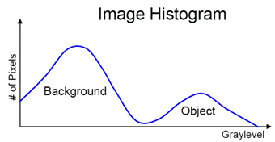
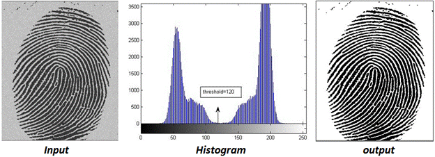
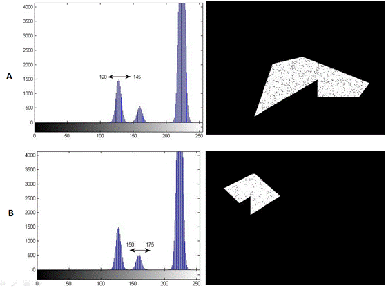
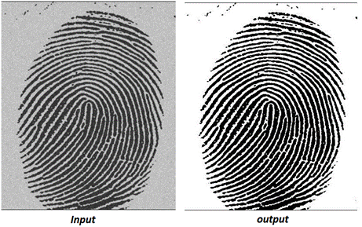
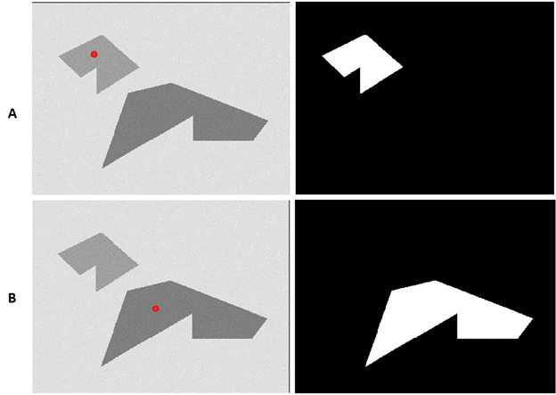

Image segmentation is the process of dividing an image into meaningful regions so that the pixels belonging to an object or region of interest can be distinguished from the rest of the image. It is an important step in many image processing applications because subsequent analysis often needs to operate on a particular object or region rather than on the complete image.

For example, segmentation can be used to separate a character from a document, isolate an object from its background, or identify a region with a particular intensity characteristic.

The central idea of **image segmentation** is to assign pixels to different regions according to some property that distinguishes one region from another. Depending on the application, this property may be intensity, colour, texture, or another image feature.

In the **Image Segmentation experiment**, the focus is on segmentation based primarily on **pixel intensity**. Two approaches are studied:

1. **Histogram-based thresholding**
2. **Region growing**

The purpose of the **Image Segmentation experiment** is therefore to understand how an image can be divided into meaningful regions using intensity information, how different segmentation parameters affect the result, and why the characteristics of the input image influence the choice of segmentation technique.

### Basic Terminology

Before studying the segmentation techniques, it is useful to understand a few basic terms.

**Image:**
A digital image can be represented as a two-dimensional function

$$
I(x,y)
$$

where \(x\) and \(y\) represent the pixel coordinates and \(I(x,y)\) represents the intensity value at that location.

**Region:**
A region is a set of connected pixels having similar characteristics according to the criterion used for segmentation.

**Foreground:**
The foreground represents the object or region of interest that we want to extract.

**Background:**
The background represents the remaining part of the image that is not the primary region of interest.

**Segmentation:**
Segmentation assigns pixels to different regions according to a selected criterion.

For a simple foreground-background segmentation, the output can be represented as a binary image:

$$
S(x,y) \in \{0,1\}
$$

where one value represents the foreground and the other represents the background. The particular display values used for the two classes depend on the application.

The segmentation problem can therefore be viewed conceptually as

$$
\text{Input Image}
\longrightarrow
\text{Segmentation Criterion}
\longrightarrow
\text{Foreground and Background Regions}
$$

The important point is that the segmentation criterion must be chosen according to the characteristics of the image and the region that needs to be extracted.

### Intensity-Based Image Segmentation

In this experiment, segmentation is based primarily on the intensity of pixels.

Suppose the required object has intensity values that are sufficiently different from those of the background. The intensity values can then be used to distinguish the object from its surroundings.

For example, if the object is generally brighter than the background, pixels with sufficiently high intensity can be classified as foreground. If the object is darker than the background, pixels with sufficiently low intensity can be classified as foreground.

This makes intensity-based segmentation particularly useful when the foreground and background have distinguishable intensity characteristics.

However, the intensity values of an object are not always uniform. Variations in illumination, object appearance, and image acquisition can make segmentation more difficult. Therefore, the suitability of a segmentation method depends on the image being processed.

### Histogram-Based Thresholding

An image histogram represents the distribution of pixel intensities in an image. When the foreground and background have significantly different intensity ranges, the histogram can provide useful information for selecting a threshold.

A threshold is an intensity value used to divide pixels into different classes.

Consider an intensity threshold \(T\). A simple thresholding rule can be written as

$$
S(x,y)=
\begin{cases}
1, & I(x,y) \geq T \\
0, & I(x,y) < T
\end{cases}
$$

Here:

- \(I(x,y)\) is the intensity of the input image at location \((x,y)\);
- \(T\) is the selected threshold;
- \(S(x,y)\) is the resulting segmented image; and
- \(0\) and \(1\) represent the two segmentation classes.

The assignment of \(0\) and \(1\) to foreground and background can be reversed depending on which intensity range corresponds to the object of interest.

The histogram therefore helps identify an intensity value that can separate the required region from the background.

_Figure 1: Histogram showing the distribution of image intensities used to identify a suitable threshold._

The figure illustrates the relationship between pixel intensity and the number of pixels having that intensity. When two dominant groups of pixels occur at different intensity ranges, a threshold can potentially be selected between them.

This type of histogram is often described as **bimodal**, because it contains two dominant groups or peaks corresponding approximately to the two regions.

### Single Threshold

The simplest thresholding technique uses one threshold value.

For an image \(I(x,y)\), the output can be defined as

$$
S(x,y)=
\begin{cases}
1, & I(x,y) \geq T \\
0, & I(x,y) < T
\end{cases}
$$

If the object of interest is darker than the background, the classification rule can instead be reversed:

$$
S(x,y)=
\begin{cases}
1, & I(x,y) < T \\
0, & I(x,y) \geq T
\end{cases}
$$

The choice of the inequality depends on whether the foreground is brighter or darker than the background.

_Figure 2: Binary segmentation obtained using a single intensity threshold._

The figure illustrates how selecting a threshold converts a grayscale image into two classes. Pixels satisfying the threshold condition are assigned to one class, while the remaining pixels are assigned to the other.

A single threshold works particularly well when the histogram has two clearly separated intensity groups. In such a case, the threshold can be selected in the region between the two groups.

However, a single threshold may not be sufficient when the image contains several objects with different intensity values or when the object itself contains significant intensity variation.

### Double Threshold

In some images, two threshold values are useful for selecting pixels within a particular intensity range.

Let \(T_1\) and \(T_2\) be two thresholds, with

$$
T_1 < T_2
$$

A range-based segmentation can be defined as

$$
S(x,y)=
\begin{cases}
1, & T_1 \leq I(x,y) \leq T_2 \\
0, & \text{otherwise}
\end{cases}
$$

This approach selects pixels whose intensities lie within the specified range.

_Figure 3: Input image containing regions with different intensity characteristics._

_Figure 4: Segmentation results obtained using different pairs of threshold values._

The figures demonstrate that changing the threshold values changes which regions are selected. A threshold range that is too narrow may exclude parts of the desired object, whereas a range that is too wide may include unwanted regions.

Thus, threshold selection has a direct effect on the quality of the segmentation result.

### Automatic Threshold Selection — Otsu's Method

Selecting a threshold manually is not always convenient, particularly when many images need to be processed or when the appropriate threshold is not obvious.

An automatic thresholding method can instead analyse the intensity distribution and determine a suitable threshold.

One commonly used method is **Otsu's method**. It is particularly useful when the image histogram is approximately bimodal, with the two groups corresponding approximately to foreground and background pixels.

Otsu's method selects the threshold that gives the best separation between the two classes according to their within-class variance.

Let \(p(i)\) represent the normalized histogram value at intensity \(i\). For a candidate threshold \(T\), the two classes can be represented as:

$$
C_0=\{0,\ldots,T-1\}
$$

and

$$
C_1=\{T,\ldots,L-1\}
$$

where \(L\) is the number of possible intensity levels.

The class probabilities are

$$
\omega_0(T)=\sum_{i=0}^{T-1}p(i)
$$

and

$$
\omega_1(T)=\sum_{i=T}^{L-1}p(i)
$$

The within-class variance is

$$
\sigma_{\text{within}}^2(T)
=
\omega_0(T)\sigma_0^2(T)
+
\omega_1(T)\sigma_1^2(T)
$$

where \(\sigma_0^2(T)\) and \(\sigma_1^2(T)\) are the variances of the two classes.

Otsu's method selects the threshold that minimizes this within-class variance:

$$
T^\ast
=
\operatorname*{arg\,min}_{T}
\sigma_{\text{within}}^2(T)
$$

The important idea is that the selected threshold attempts to divide the image into two intensity classes that are as internally consistent as possible.

_Figure 5: Segmentation result obtained using Otsu's automatic threshold selection._

The figure illustrates the result of automatically selecting a threshold from the intensity distribution. The method is particularly appropriate when the foreground and background form reasonably distinct intensity groups.

Otsu's method does not guarantee a satisfactory result for every image. Its effectiveness depends on whether the intensity distribution of the image is suitable for separating the required regions.

### Region Growing

Thresholding classifies pixels primarily according to their individual intensity values. However, some images cannot be segmented effectively using a single intensity threshold.

In such cases, the pixels belonging to an object may still exhibit **local similarity**. Region growing uses this property to build a region starting from one or more selected **seed pixels**.

A seed pixel is a pixel selected as a starting point inside the region of interest.

Starting from the seed, neighbouring pixels are examined. A neighbouring pixel is added to the growing region if it satisfies the selected similarity criterion.

The basic process can be represented as

$$
\text{Seed Pixel}
\longrightarrow
\text{Examine Neighbours}
\longrightarrow
\text{Test Similarity}
\longrightarrow
\text{Add Similar Pixels}
\longrightarrow
\text{Repeat}
$$

Let \(S\) denote the set of pixels currently belonging to the growing region. Initially, \(S\) contains the seed pixel.

A neighbouring pixel is considered for inclusion according to a similarity condition. For example, if the intensity of a candidate pixel is sufficiently close to the current region mean, it can be included in the region.

A simple mean-based condition can be expressed as

$$
\left|I(x,y)-\mu_S\right|\leq \Delta
$$

where:

- \(I(x,y)\) is the intensity of the candidate pixel;
- \(\mu_S\) is the mean intensity of the current region; and
- \(\Delta\) is the permitted intensity difference.

If the condition is satisfied, the pixel can be added to the region. The process continues using newly included pixels until no additional neighbouring pixels satisfy the criterion.

_Figure 6: Region-growing results obtained using different seed-point selections._

The figure demonstrates that the choice of seed point can significantly affect the resulting segmented region. A seed located inside one object may cause the region to grow through pixels belonging to that object, while a seed placed in another region may produce a different result.

The similarity criterion and its permitted range also influence how far the region grows.

### Effect of Seed Selection and Similarity Criteria

Region growing depends on both the starting point and the rule used to decide whether neighbouring pixels are sufficiently similar.

If the similarity condition is too restrictive, only a small portion of the desired object may be selected.

If the condition is too permissive, pixels belonging to neighbouring regions may also be included.

Similarly, a seed point located near a boundary may cause the growing process to behave differently from a seed point located near the centre of the desired object.

Therefore, the region-growing result depends on:

- the location of the seed pixel;
- the neighbourhood considered around each pixel;
- the similarity criterion; and
- the permitted similarity range.

These parameters must be selected according to the characteristics of the image and the region of interest.

### Comparing Thresholding and Region Growing

Thresholding and region growing both aim to separate a required region from the rest of an image, but they use different principles.

**Thresholding** primarily uses the intensity value of each pixel relative to one or more threshold values.

**Region growing** starts from a selected seed and uses the similarity of neighbouring pixels to construct a connected region.

The difference can be summarized as follows:

| Segmentation approach | Main principle                                                   | Important parameter            |
| --------------------- | ---------------------------------------------------------------- | ------------------------------ |
| Single threshold      | Separate pixels using one threshold                              | Threshold \(T\)                |
| Double threshold      | Select pixels within an intensity range                          | \(T_1\) and \(T_2\)            |
| Otsu's method         | Automatically select a threshold from the intensity distribution | Automatically determined \(T\) |
| Region growing        | Expand a connected region from a seed using similarity           | Seed and similarity criterion  |

The appropriate technique depends on the image. A thresholding method may be effective when foreground and background have clearly different intensity distributions, whereas region growing can be more useful when the desired region is locally homogeneous but cannot be separated reliably using a single global threshold.

### Quality of a Segmentation Result

A segmentation result should not be judged only by whether an output image has been produced. The important question is whether the output contains the **required region while excluding as much unwanted information as possible**.

When examining a segmentation result, consider:

- whether the complete object of interest has been extracted;
- whether parts of the object have been incorrectly excluded;
- whether unwanted background pixels have been included;
- whether separate objects have been incorrectly merged;
- whether small unwanted regions remain in the result; and
- whether changing the threshold, seed point, or similarity criterion improves the result.

This is particularly important because no single segmentation parameter is guaranteed to work equally well for every image.

### Limitations of Intensity-Based Segmentation

Intensity-based segmentation is useful when the regions of interest have distinguishable brightness characteristics. However, several factors can make segmentation difficult.

If the foreground and background have overlapping intensity ranges, a simple threshold may not separate them effectively.

Uneven illumination can cause the same object to have different intensity values at different locations.

Objects may also contain internal intensity variations, making it difficult to represent the entire object using one threshold.

In such situations, region growing may provide a useful alternative when the desired region has sufficient local similarity.

These limitations highlight an important principle of the **Image Segmentation experiment**: the segmentation technique and its parameters should be selected based on the characteristics of the image rather than applied without considering the image content.

### What to Observe in the Image Segmentation Experiment

In the **Image Segmentation experiment**, pay particular attention to the relationship between the input image, the segmentation criterion, and the resulting regions.

Observe:

- how the intensity distribution of an image can help identify foreground and background regions;
- how changing a single threshold changes the segmented output;
- how two thresholds can be used to select a particular intensity range;
- how Otsu's method determines a threshold automatically from the image intensity distribution;
- how the choice of threshold affects which regions are included or excluded;
- how the location of the seed pixel affects region-growing results;
- how the similarity criterion controls the growth of a region;
- how an overly restrictive criterion can produce incomplete regions;
- how an overly permissive criterion can include unwanted regions; and
- why different images may require different segmentation techniques or parameter values.

These observations connect the concepts of image intensity, histograms, threshold selection, connectivity, and region similarity with the practical task of extracting meaningful regions from an image.

### Understanding the Image Segmentation Experiment

The central idea of the **Image Segmentation experiment** is that an image can be divided into meaningful regions by identifying characteristics that distinguish one region from another.

In this experiment, intensity is used as the primary characteristic. Histogram-based thresholding separates pixels according to selected intensity ranges, while region growing uses a seed point and a similarity criterion to construct a connected region.

The complete segmentation process can therefore be viewed as

$$
\text{Input Image}
\longrightarrow
\text{Analyse Image Characteristics}
\longrightarrow
\text{Select Segmentation Method}
\longrightarrow
\text{Choose Parameters}
\longrightarrow
\text{Segmented Region}
$$

The key learning outcome of the **Image Segmentation experiment** is not simply to obtain a binary image. It is to understand **how the characteristics of an image influence the choice of segmentation method and parameters, and how those choices affect the extracted regions**.

By experimenting with threshold values, automatic threshold selection, seed points, and similarity criteria, the relationship between the segmentation method and the quality of the resulting regions can be observed directly.
